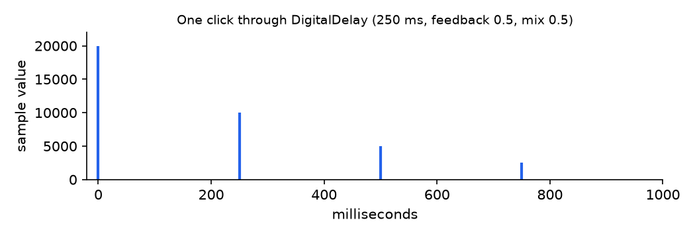

# audioeffects

audioeffects is the part of OmniPython that shapes sound: 45 effects (compressors,
EQs, reverbs, delays, modulation, drive and amp simulation, pitch shifters and
racks), pure Python on audiodsp's audio nodes, the same on MicroPython-compatible
boards, CircuitPython-compatible boards and a desktop.

```bash
pip install -i https://test.pypi.org/simple/ --extra-index-url https://pypi.org/simple/ omnipython-audioeffects
```

```python
import mip
mip.install("audioeffects", index="https://PyDevices.github.io/mip")
```

The first is for a desktop. The second is for a board whose firmware carries
audiodsp; [Install](docs/get-started/install.md) has the rest.

```python
import array
import audiocore
import audioeffects

RATE = 48000
click = array.array("h", [20000] + [0] * (RATE - 1))  # one click, one second
source = audiocore.RawSample(click, sample_rate=RATE, channel_count=1)
echo = audioeffects.create("DigitalDelay", source, RATE,
                           time_ms=250, feedback=0.5, mix=0.5)
heard = array.array("h")
while len(heard) < RATE:
    _, block = audiocore.get_buffer(echo.output)
    heard.extend(array.array("h", bytes(block)))
for ms in range(0, 1000, 250):
    start = ms * RATE // 1000
    print(ms, "ms: loudest sample", max(abs(v) for v in heard[start:start + 12000]))
```

```text
0 ms: loudest sample 20000
250 ms: loudest sample 10000
500 ms: loudest sample 5000
750 ms: loudest sample 2500
```

That sends one click through a digital delay and prints how loud each echo is:
every repeat is half the one before, because feedback is 0.5. On a board, hand
`echo.output` to `audio_out.play()` instead of pulling it yourself.

[Docs](docs/index.md) · [Examples](examples/) · [Roadmap](ROADMAP.md)

OmniPython is made by [PyDevices](https://pydevices.com).
